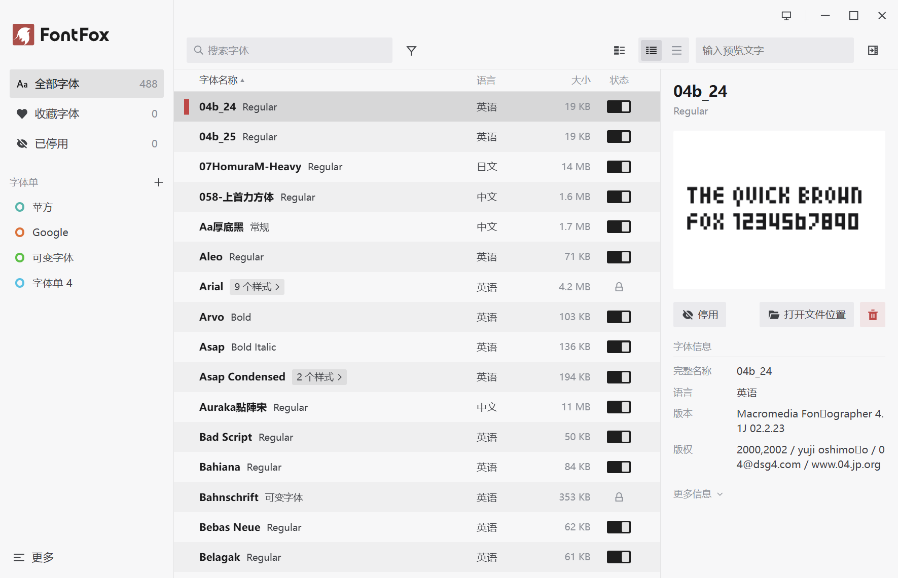
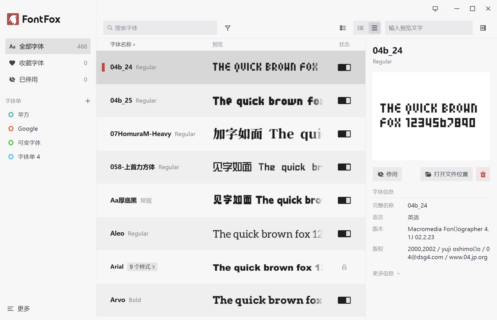

<div align="center">


# FontFox 字狐
### 快速流畅且易用的本地字体管理器

Made with ❤️ by [羽梦千景 Raku Inkyetta](https://github.com/AomiRaku)

</div>

## 快速开始

下载请点击 [此处](https://github.com/AomiRaku/font-fox/releases/latest) 访问最新发布版页面。

也可从仓库源码自行编译构建。


## 简述

FontFox 是一个 Windows 平台的**本地字体管理器**，提供了**浏览字体**、**预览字体效果**、**查看字体详情**、**删除字体**、**快速禁用和启用字体**的功能。

浏览可**搜索**字体，可**筛选**字体，也可**按类型分组**查看字体。受保护的系统字体会单独标注。

可以创建收藏字体或创建 **字体单** 。将字体加入字体单，方便成组管理和查看，也可以快速启用和禁用某个字体单里的所有字体。

禁用字体默认采用临时卸载的方式，保证在 Adobe 等第三方软件中，也可以尽可能免重启更新字体列表。当然同时提供 Windows 自带的字体隐藏方式可选，但此方式对大多第三方软件无效。


## 功能

FontFox 包含以下功能：

- 浏览和预览字体、收藏字体、查看字体详情、删除字体、快速禁用和启用字体。
- 搜索、筛选、分组查看已安装字体。
- 创建字体单，分类管理字体。
- 检查出缺失了字体文件的字体注册信息。
- 自动检查软件更新，支持 GitHub 与 GitHub 镜像源，可在设置中切换。

界面截图：






## 系统版本支持

推荐使用 **Windows 11** ；
最低支持 Windows 10 1809（64 位）。


## 仓库目录结构

```
src/                前端：入口 main.ts、虚拟列表、行渲染、详情、菜单、i18n等
src/assets/icons/   自绘图标扩展目录
src-tauri/src/      Rust：枚举、解析、保护判定、隐藏/删除、提权、设置与字体单存储
src-tauri/src/data/ 系统内置字体清单（system_fonts.json / core_fonts.json）
langBuild/          语言包编辑目录（构建时会复制到 exe 同级 lang/）
docs/               UI 规范、架构说明、开发文档、截图
tools/              语言包复制、第三方许可证生成、设计稿解析脚本
```


## 多语言

内置简体中文、English (US)、Français、Русский、日本語、한국어、繁體中文（香港 / 台灣 / 澳門 / 文言）；默认跟随系统语言。语言包存放于软件运行目录 `lang` 文件夹内，可继续添加翻译。


## 开发者

- 详细开发文档，请参阅 [FontFox 开发文档](docs/development.md) 。
- 架构相关，请参阅 [FontFox 架构说明](docs/architecture.md) 。
- UI规范相关，请参阅 [FontFox UI 规范](docs/ui-spec.md) 。


## 其他

- 字体管理功能完全本地运行；仅检查更新时会访问网络。
- 本项目以 Tauri + Rust 构建。界面由 WebView2 渲染，无内置浏览器。
- 字体预览由 Rust 栅格化，前端只缓存位图，避免 WebView 加载字体文件。
- 卸载时，若禁用模式处于动态卸载模式，则会强制恢复所有已停用字体。
- 本项目采用 [Apache 2.0 协议](LICENSE) ，第三方组件与数据来源见 [NOTICE](NOTICE)。
